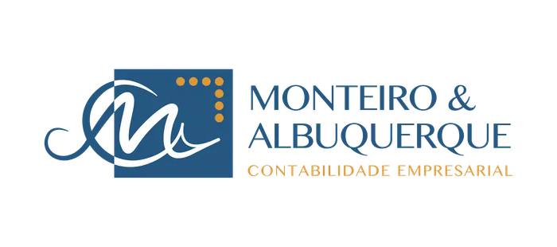
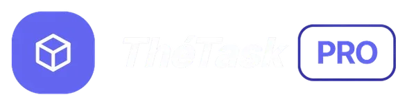

# Olá, eu sou o Gustavo Thé

**Desenvolvedor Full Stack com foco em Front-end · Interfaces e soluções que funcionam de verdade**

---

## 👨‍💻 Sobre mim

Sou **desenvolvedor Full Stack com maior foco no ecossistema Front-end**. Atuo na construção de aplicações limpas, acessíveis e bem estruturadas de ponta a ponta, com um olhar especial para a experiência do usuário e a interface. Acredito que bom código é aquele que resolve o problema **certo**, da forma mais simples e eficiente possível.

- 🎯 **Foco atual:** Arquitetura Full Stack · React & TypeScript · Integrações com IA e Automações
- 🧱 **Gosto de construir:** dashboards, sistemas de gestão, autenticação e produtos web completos — do banco ao pixel
- 🌱 **Sempre aprendendo:** Clean Architecture, segurança de aplicações e boas práticas de cloud
- 🤝 **Aberto a:** oportunidades, freelas e colaborações em projetos web

---

## 🚀 Projetos em destaque

Construo estes projetos em público, um dia de cada vez, com roadmap, decisões registradas e testes. Eles mostram a minha evolução em **Java, C#, SQL e IA**, da base até o nível de produção.

<table>
  <tr>
    <td width="50%" valign="top">
      
      <h3><a href="https://github.com/GustavoThe01/mimir-ai">ᛗ Mimir</a></h3>
      
Assistente de conhecimento com LLM, Fine-Tuning, Enterprise RAG, MCP e Agentes Autônomos. Roda com modelos locais, sem custo, e já está pronto para trocar por APIs pagas.

      

        
        
        
      

      Dia 10 de 20 · v0.2.0 · 126 testes · RAG com permissão por perfil
    </td>
    <td width="50%" valign="top">
      
      <h3><a href="https://github.com/GustavoThe01/bifrost-orders">✦ Bifrost</a></h3>
      
API de pedidos com ASP.NET Core, Clean Architecture e CQRS, avançando até Outbox, resiliência e OpenTelemetry.

      

        
        
        
        
      

      Dia 12 de 20 · v0.2.0 · 137 testes · autorização por dono do pedido
    </td>
  </tr>
  <tr>
    <td width="50%" valign="top">
      
      <h3><a href="https://github.com/GustavoThe01/moirai-taskflow">♾ Moirai</a></h3>
      
API REST de projetos e tarefas com Spring Boot e Arquitetura Hexagonal, avançando até JWT, Docker e observabilidade.

      

        
        
        
        
      

      Dia 12 de 20 · v0.2.0 · 155 testes · JWT com refresh token
    </td>
    <td width="50%" valign="top">
      
      <h3><a href="https://github.com/GustavoThe01/plutus-ledger">⚖ Plutus</a></h3>
      
Livro-razão bancário com DDD: contas, depósitos, saques e transferências, com regras protegidas pelo próprio domínio.

      

        
        
        
        
      

      ✅ v1.0.0 · 147 testes · 93,6% de cobertura · executável na release
    </td>
  </tr>
  <tr>
    <td width="50%" valign="top">
      
      <h3><a href="https://github.com/GustavoThe01/nidavellir-inventory">⚒ Nidavellir</a></h3>
      
Controle de estoque em Java puro, sem frameworks: POO, SOLID, Design Patterns, Streams e JDBC feitos à mão.

      

        
        
        
      

      ✅ v1.0.0 · 117 testes · 88% de cobertura · jar na release
    </td>
    <td width="50%" valign="top">
      
      <h3><a href="https://github.com/GustavoThe01/mercurium-sql">☿ Mercurium</a></h3>
      
Laboratório de modelagem e SQL avançado em um e-commerce: normalização, CTEs, window functions, triggers e índices.

      

        
        
      

      ✅ v1.0.0 · 20 testes SQL no CI
    </td>
  </tr>
</table>

<b>Outros projetos</b> · em produção

 

<table>
  <tr>
    <td width="50%" valign="top">
      
      <h4><a href="https://monteiroealbuquerque.com.br">Monteiro &amp; Albuquerque Contabilidade</a></h4>
      
Portal contábil e empresarial com área do cliente, login com Google e agendamento de consultoria por vídeo.

      
<a href="https://monteiroealbuquerque.com.br">🌐 monteiroealbuquerque.com.br</a> · código privado

    </td>
    <td width="50%" valign="top">
      
      <h4><a href="https://ecos-of-aethelgard.web.app">Ecos de Aethelgard</a></h4>
      
RPG tático de fantasia sombria no navegador, com grupo, masmorras e batalhas isométricas por turnos.

      
<a href="https://ecos-of-aethelgard.web.app">🌐 ecos-of-aethelgard.web.app</a> · código privado

    </td>
  </tr>
  <tr>
    <td width="50%" valign="top">
      
      <h4><a href="https://gr-wedding.web.app">G | R Wedding</a></h4>
      
Portal de casamento com convite individual, painel do convidado e painel dos noivos.

      
<a href="https://gr-wedding.web.app">🌐 gr-wedding.web.app</a> · código privado

    </td>
    <td width="50%" valign="top">
      
      <h4><a href="https://ceara-horizonte-turismo.web.app">Ceará Horizonte Turismo</a></h4>
      
Portal de turismo receptivo com pacotes, passeios, captação de leads e conteúdo editável em tempo real.

      
<a href="https://ceara-horizonte-turismo.web.app">🌐 ceara-horizonte-turismo.web.app</a> · <a href="https://github.com/GustavoThe01/ceara-horizonte-viagens">📁 ceara-horizonte-viagens</a>

    </td>
  </tr>
  <tr>
    <td width="50%" valign="top">
      
      <h4><a href="https://crazylifewow.web.app">Guilda CrazyLife — WoW</a></h4>
      
Portal de guilda de World of Warcraft, integrado à API da Blizzard para acompanhar o progresso dos personagens.

      
<a href="https://crazylifewow.web.app">🌐 crazylifewow.web.app</a> · código privado

    </td>
    <td width="50%" valign="top">
      
      <h4><a href="https://pizzaria-forno-de-pedra.web.app">Pizzaria Forno de Pedra</a></h4>
      
Site e cardápio digital para pizzaria, com produtos artesanais e canais de pedido.

      
<a href="https://pizzaria-forno-de-pedra.web.app">🌐 pizzaria-forno-de-pedra.web.app</a> · código privado

    </td>
  </tr>
  <tr>
    <td width="50%" valign="top">
      
      <h4><a href="https://gthe-task-manager.web.app">ThéDesk Task Manager</a></h4>
      
Aplicação web para gerenciar e acompanhar tarefas de forma ágil, com interface interativa.

      
<a href="https://gthe-task-manager.web.app">🌐 gthe-task-manager.web.app</a> · código privado

    </td>
    <td width="50%"></td>
  </tr>
</table>

---

## 🛠️ Stack Tecnológico

| Área | Tecnologias |
|---|---|
| **Linguagens** |        |
| **Front-end & UI** |       |
| **Back-end & APIs** |       |
| **Banco de dados & Segurança** |     |
| **Cloud & DevOps** |        |
| **Integrações & IA** |    |

---

## 📊 Estatísticas no GitHub

### 🏆 Troféus

---

## 💡 Valores que guiam meu trabalho

| | |
|---|---|
| 🔍 **Clareza** | Código legível vale mais que código inteligente. |
| 📈 **Consistência** | Pequenos avanços todo dia constroem grandes resultados. |
| 🎯 **Impacto** | Tecnologia que não resolve um problema real não tem valor. |

---

*"Meu objetivo é tornar-me um profissional eficiente,*
*capaz de impactar vidas com o fruto do meu trabalho."*

 

**Vamos conversar?** Me encontre no [LinkedIn](https://linkedin.com/in/gustavoosterno) ou conheça meu [portfólio](https://site-gustavothe-dev.web.app/).

